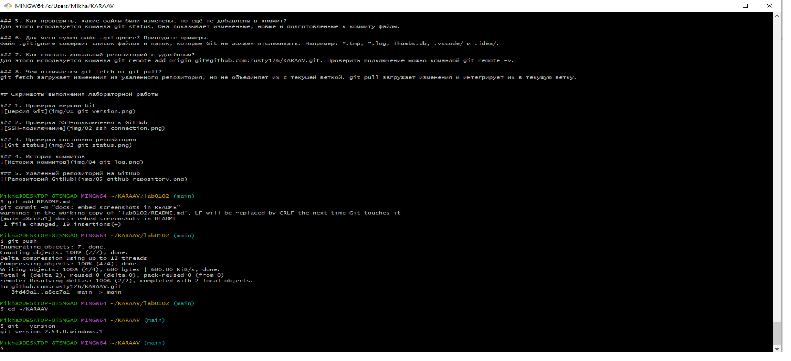
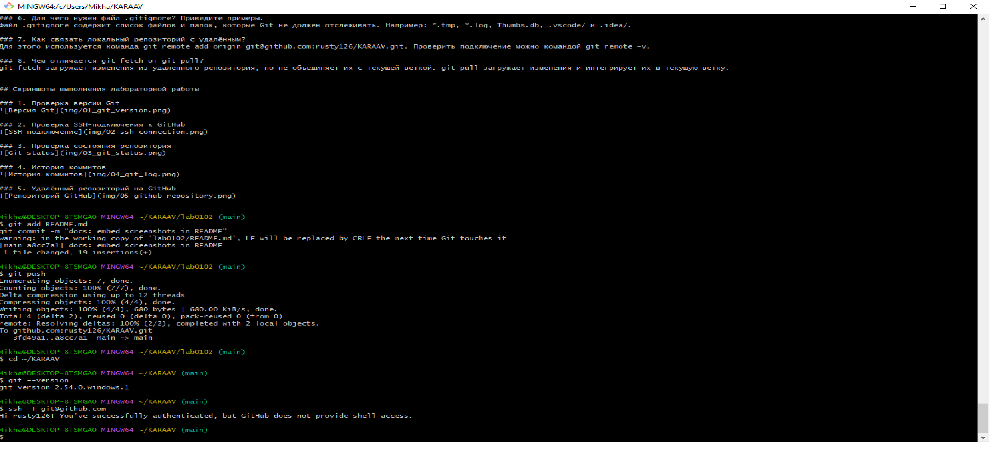
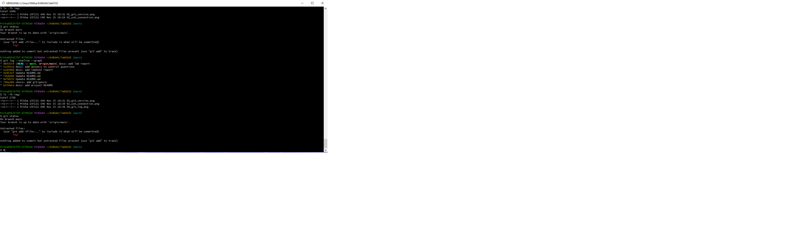
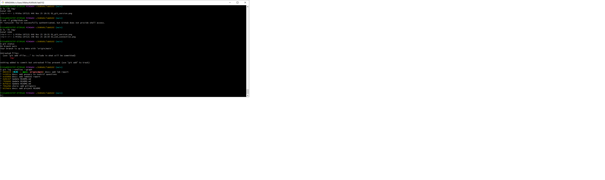
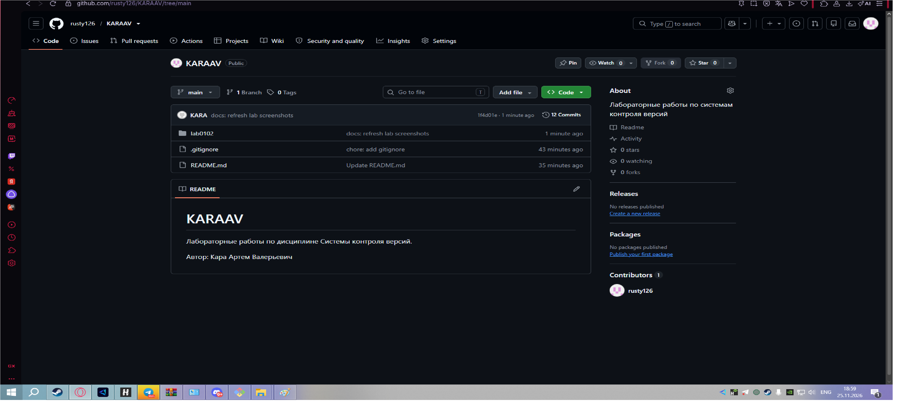

# Лабораторная работа №1

## Дисциплина
Системы контроля версий

## Выполнил
Кара Артем Валерьевич

## Группа
ПИН-б-о-24-1

## Тема
Знакомство с Git и GitHub. Создание репозитория и работа с SSH.

## Цель работы
Изучить основы системы контроля версий Git, освоить создание локального и удалённого репозиториев, настройку SSH-подключения и основные команды Git.

## Используемые инструменты
- Windows
- Git Bash
- Git
- GitHub
- SSH

## Ход работы
1. Установлен Git.
2. Настроены имя пользователя и электронная почта.
3. Создан SSH-ключ Ed25519.
4. Добавлен публичный SSH-ключ в GitHub.
5. Проверено SSH-подключение к GitHub.
6. Создан локальный репозиторий KARAAV.
7. Создан файл README.md.
8. Выполнен первый коммит.
9. Создан удалённый репозиторий на GitHub.
10. Настроено подключение локального репозитория к удалённому.
11. Выполнена отправка изменений командой git push.
12. Создан файл .gitignore.

## Ссылка на репозиторий
https://github.com/rusty126/KARAAV

## Вывод
В ходе лабораторной работы изучены основные возможности Git и GitHub. Получены практические навыки создания репозитория, настройки SSH-подключения, выполнения коммитов и отправки изменений на удалённый сервер.

## Контрольные вопросы

### 1. Что такое распределённая система контроля версий и чем она отличается от централизованной?
Распределённая система контроля версий — это система, в которой каждый участник имеет полную копию репозитория и его истории изменений. В централизованной системе все изменения хранятся на одном центральном сервере. Git является распределённой системой контроля версий.

### 2. Для чего нужен SSH-ключ при работе с GitLab?
SSH-ключ используется для безопасной аутентификации пользователя при подключении к удалённому репозиторию. Он состоит из публичного и приватного ключей. Публичный добавляется на сервер, а приватный хранится на компьютере пользователя.

### 3. В чём разница между git add и git commit?
git add добавляет изменения в индекс, подготавливая их к сохранению. git commit сохраняет подготовленные изменения в истории локального репозитория.

### 4. Что такое staging area (индекс) в Git?
Staging area — промежуточная область, в которую помещаются изменения перед созданием коммита. Она позволяет выбрать, какие изменения попадут в следующий коммит.

### 5. Как проверить, какие файлы были изменены, но ещё не добавлены в коммит?
Для этого используется команда git status. Она показывает изменённые, новые и подготовленные к коммиту файлы.

### 6. Для чего нужен файл .gitignore? Приведите примеры.
Файл .gitignore содержит список файлов и папок, которые Git не должен отслеживать. Например: *.tmp, *.log, Thumbs.db, .vscode/ и .idea/.

### 7. Как связать локальный репозиторий с удалённым?
Для этого используется команда git remote add origin git@github.com:rusty126/KARAAV.git. Проверить подключение можно командой git remote -v.

### 8. Чем отличается git fetch от git pull?
git fetch загружает изменения из удалённого репозитория, но не объединяет их с текущей веткой. git pull загружает изменения и интегрирует их в текущую ветку.

## Скриншоты выполнения лабораторной работы

### 1. Проверка версии Git

### 2. Проверка SSH-подключения к GitHub

### 3. Проверка состояния репозитория

### 4. История коммитов

### 5. Удалённый репозиторий на GitHub

