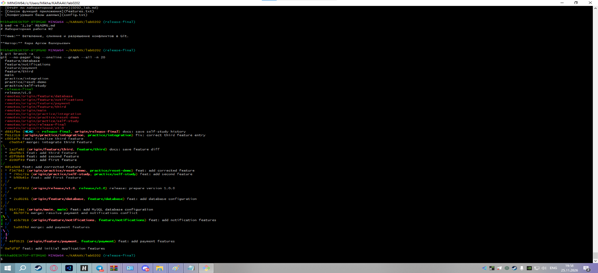
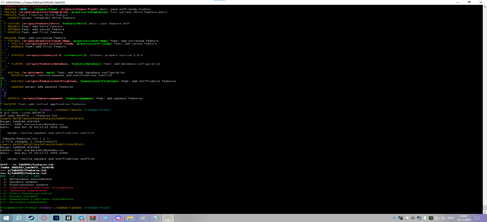
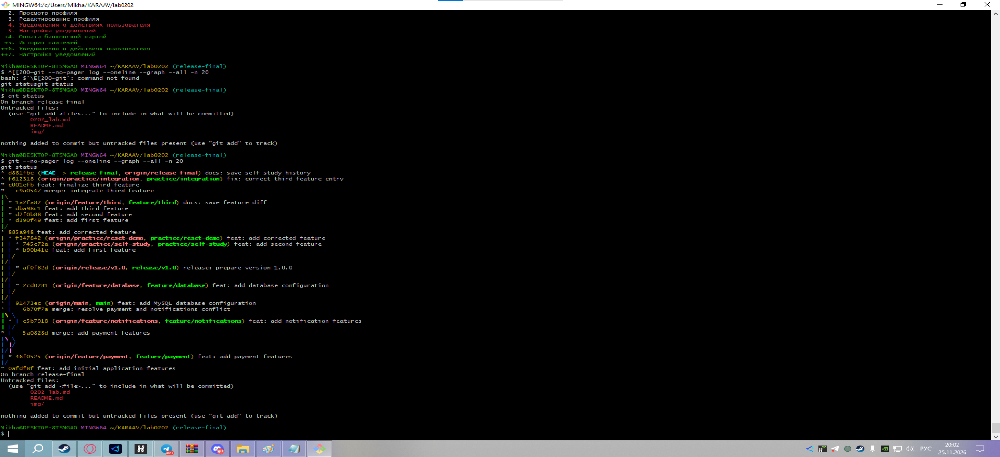
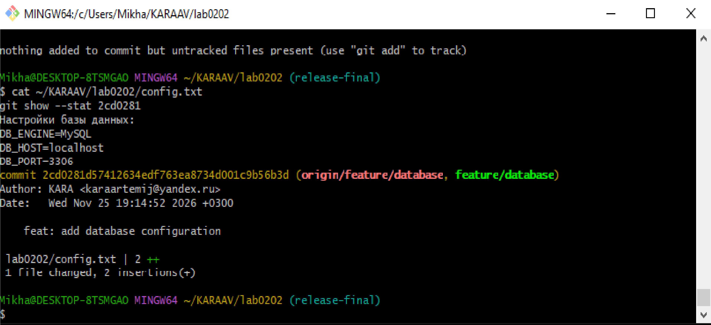
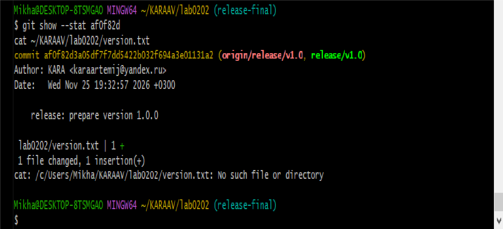
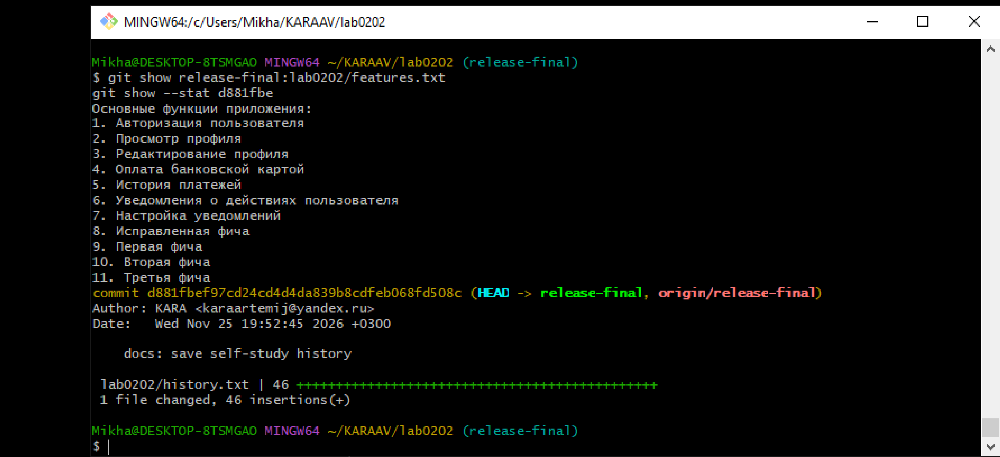

# Лабораторная работа №2

**Тема:** Ветвление, слияние и разрешение конфликтов в Git.

**Автор:** Кара Артем Валерьевич  
**Группа:** ПИН-б-о-24-1

## Содержание

- [Отчёт по лабораторной работе](0202_lab.md)
- [Список функций приложения](features.txt)
- [Конфигурация базы данных](config.txt)
- [Разница между коммитами](diff.txt)
- [История коммитов и веток](history.txt)

## Основные результаты

- Создание и переключение веток Git.
- Слияние веток с помощью merge.
- Разрешение конфликтов слияния.
- Использование rebase и reset.
- Создание релизных веток.
- Публикация веток в GitHub.

## Скриншоты

Скриншоты выполнения лабораторной работы находятся в каталоге [img](img/).

## Скриншоты выполнения

### 1. Ветки и история коммитов

### 2. Разрешение конфликта при merge

### 3. Rebase и история

### 4. Конфигурация базы данных

### 5. Создание релизной версии

### 6. Самостоятельное задание

