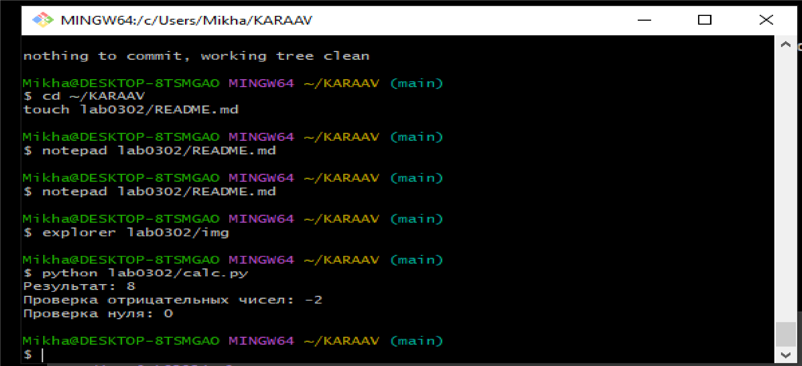
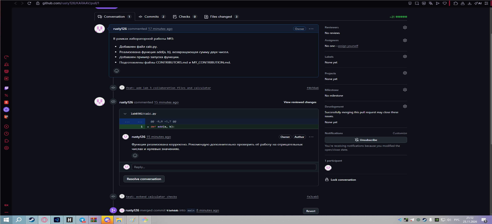
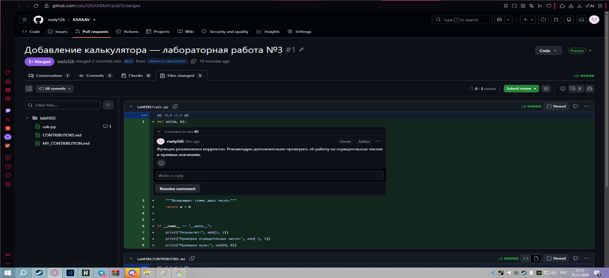
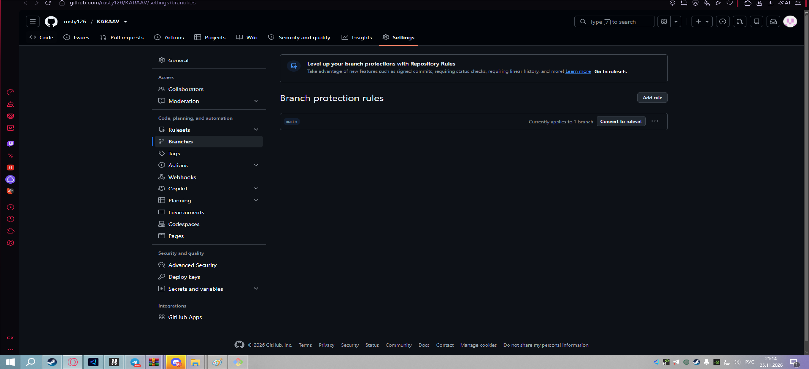
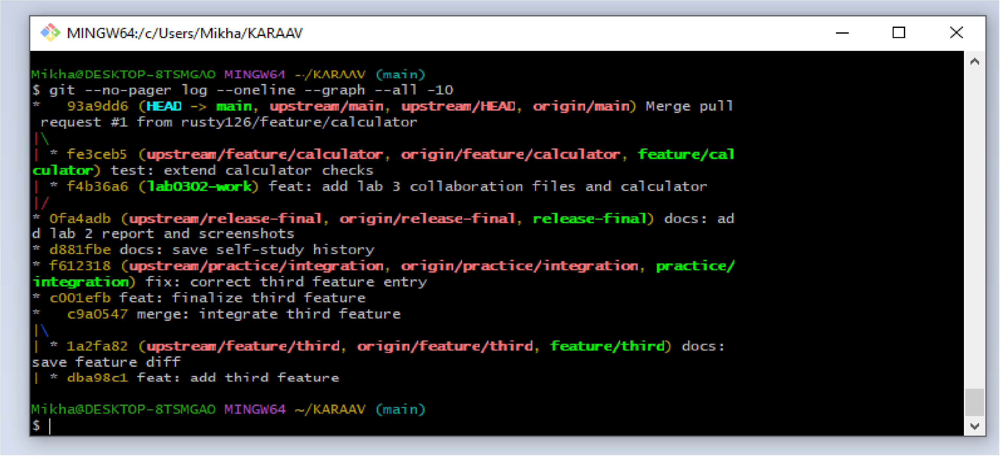
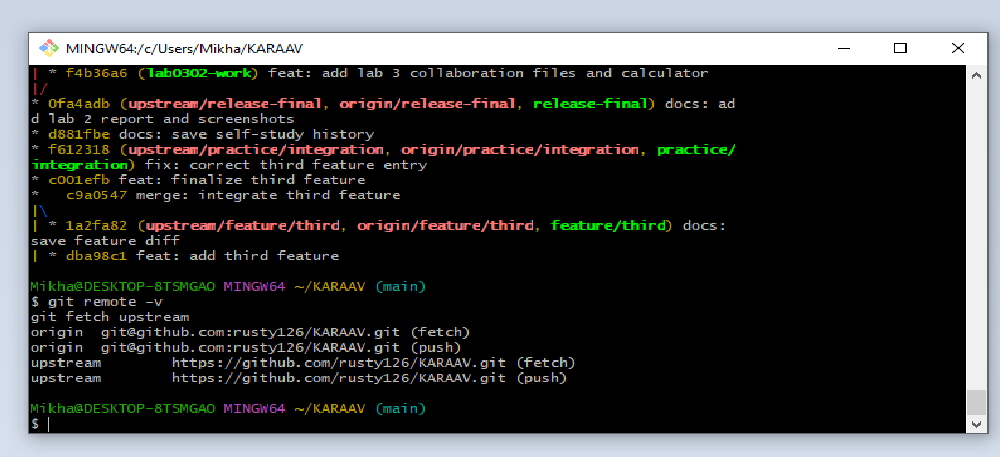

# Лабораторная работа №3

## Работа с удалёнными репозиториями. Совместная разработка в GitHub

**Дисциплина:** Системы контроля версий  
**Выполнил:** Кара Артем Валерьевич  
**Группа:** ПИН-б-о-24-1

---

## 1. Цель работы

Изучить работу с удалёнными репозиториями Git, освоить команды `fetch`, `pull`, `push`, научиться работать с ветками, Pull Request, Code Review и настройкой защиты основной ветки.

## 2. Используемые инструменты

- Операционная система Windows.
- Git Bash.
- Git.
- GitHub.
- Python 3.13.

Репозиторий: https://github.com/rusty126/KARAAV

## 3. Ход выполнения работы

### 3.1. Подготовка файлов проекта

В репозитории создан каталог `lab0302`, содержащий файлы:

- `CONTRIBUTORS.md` — список участников проекта.
- `MY_CONTRIBUTION.md` — описание выполненного вклада.
- `calc.py` — программа-калькулятор.
- `README.md` — отчёт по лабораторной работе.
- `img/` — каталог для скриншотов.

Создана функция сложения двух чисел:

```python
def add(a, b):
    """Возвращает сумму двух чисел."""
    return a + b


if __name__ == "__main__":
    print("Результат:", add(5, 3))
    print("Проверка отрицательных чисел:", add(-5, 3))
    print("Проверка нуля:", add(0, 0))
```

### 3.2. Создание ветки и отправка изменений

Для работы создана ветка `feature/calculator`.

Основные команды:

```bash
git switch -c feature/calculator
git add lab0302/CONTRIBUTORS.md lab0302/MY_CONTRIBUTION.md lab0302/calc.py
git commit -m "feat: add lab 3 collaboration files and calculator"
git push -u origin feature/calculator
```

### 3.3. Создание Pull Request

На GitHub создан Pull Request №1 для слияния ветки `feature/calculator` в `main`.

В запросе представлены три файла:
- `calc.py`;
- `CONTRIBUTORS.md`;
- `MY_CONTRIBUTION.md`.

### 3.4. Code Review и исправление программы

В ходе проверки кода оставлен комментарий с рекомендацией проверить работу функции на отрицательных числах и нулевых значениях.

В файл `calc.py` добавлены дополнительные проверки.

Результат выполнения программы:

```text
Результат: 8
Проверка отрицательных чисел: -2
Проверка нуля: 0
```

Исправления сохранены отдельным коммитом:

```bash
git add lab0302/calc.py
git commit -m "test: extend calculator checks"
git push
```

### 3.5. Слияние Pull Request

После проверки изменений Pull Request №1 успешно объединён с веткой `main`.

Локальная ветка обновлена:

```bash
git switch main
git pull origin main
```

Создан merge-коммит:

```text
93a9dd6 Merge pull request #1 from rusty126/feature/calculator
```

### 3.6. Работа с удалёнными репозиториями

В качестве основного удалённого репозитория используется `origin`.

Дополнительно настроено имя `upstream`, указывающее на тот же репозиторий GitHub. Это учебная демонстрация работы с несколькими remote, а не настоящий Fork другого пользователя.

Проверка удалённых репозиториев:

```bash
git remote -v
```

Получение информации об удалённых ветках:

```bash
git fetch upstream
```

Проверка различий:

```bash
git log --oneline main..upstream/main
```

Слияние изменений:

```bash
git merge upstream/main
```

Отправка изменений:

```bash
git push origin main
```

Получен результат `Already up to date`, поскольку обе ссылки указывают на один репозиторий и ветки синхронизированы.

### 3.7. Настройка защиты ветки

В настройках GitHub для ветки `main` создано правило защиты.

Включены параметры:
- Require a pull request before merging;
- Require conversation resolution before merging.

Правило применяется к одной ветке — `main`.

## 4. Ответы на контрольные вопросы

**1. Что такое удалённый репозиторий?**

Удалённый репозиторий — это копия проекта, размещённая на сервере или специальной платформе, например GitHub. Он позволяет обмениваться изменениями между разработчиками.

**2. Для чего используется команда `git remote`?**

Команда `git remote` используется для просмотра, добавления и управления ссылками на удалённые репозитории.

**3. В чём разница между `git fetch` и `git pull`?**

`git fetch` загружает информацию об изменениях из удалённого репозитория, но не объединяет их с текущей веткой. `git pull` получает изменения и объединяет их с текущей веткой.

**4. Для чего используется команда `git push`?**

`git push` отправляет локальные коммиты в удалённый репозиторий.

**5. Что такое Fork?**

Fork — это независимая копия чужого репозитория в аккаунте пользователя. Она позволяет работать над проектом без прямого доступа к исходному репозиторию.

**6. Что такое Pull Request?**

Pull Request — это запрос на включение изменений из одной ветки в другую. Он позволяет проверить изменения и обсудить их до слияния.

**7. Что такое Code Review?**

Code Review — процесс проверки исходного кода другими разработчиками или участниками проекта для обнаружения ошибок и улучшения качества программы.

**8. Для чего используется `origin` и `upstream`?**

`origin` обычно обозначает удалённый репозиторий, с которым работает разработчик. `upstream` обычно обозначает исходный репозиторий, из которого была создана копия (Fork).

**9. Что такое Protected Branches?**

Protected Branches — это механизм защиты важных веток от нежелательных изменений. Например, можно потребовать создание Pull Request перед слиянием.

**10. Зачем нужна синхронизация с удалённым репозиторием?**

Синхронизация позволяет получать актуальные изменения проекта и отправлять собственные коммиты, поддерживая согласованное состояние репозитория.

## 5. Вывод

В ходе лабораторной работы изучены основные операции с удалёнными репозиториями Git. Создана отдельная ветка, опубликованы изменения на GitHub, создан и объединён Pull Request, выполнена проверка кода и внесены дополнительные исправления.

Освоены команды `git remote`, `git fetch`, `git pull`, `git push`, `git merge`. Также изучена настройка защиты основной ветки.

В связи с использованием одного GitHub-аккаунта и одного репозитория вместо настоящего Fork и независимого ревью другого разработчика выполнена учебная демонстрация соответствующих операций внутри собственного репозитория. Вместо GitLab использовалась платформа GitHub.

## 6. Скриншоты

### 6.1. Проверка калькулятора


### 6.2. Pull Request


### 6.3. Code Review


### 6.4. Защита ветки main


### 6.5. История коммитов


### 6.6. Удалённые репозитории и fetch
